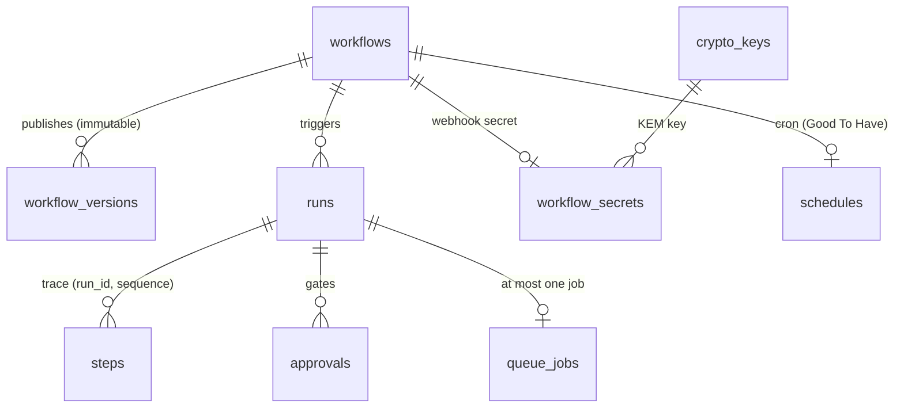

# 02 — Data model

The authoritative DDL is the Flyway migrations in `backend/src/main/resources/db/migration`
(`V1__init.sql` … `V4__pgcrypto.sql`). This page explains the choices.

| Table | Key points |
|---|---|
| `workflows` | Working copy in the seed shape **minus** `trigger.secret`; `published_version` points at the latest frozen version; `has_unpublished_changes` |
| `workflow_versions` | One row per publish, never updated (DB trigger raises on UPDATE); ML-DSA-65 signature + key id |
| `runs` | `definition_snapshot_json` (+ signature), `status` CHECK-constrained to the six contract values, `current_node_id`, `steps_executed`, `ai_tokens_used`, `error_json`, `cancel_requested`, lease mirror |
| `steps` | One row per node execution; `UNIQUE (run_id, sequence)`; partial unique index → at most one `running`/`waiting` step per run; `idempotency_key`, `resolved_input_json`, `output_json`, tokens, `resume_at`, `attempts_json` |
| `approvals` | `pending/approved/rejected/cancelled`; CHECK: decided ⇒ `decided_by` and `decided_at`; `step_sequence` lets the gate require "earlier in the run"; ML-DSA decision signature |
| `queue_jobs` | `UNIQUE (run_id)`; `available_at`, `locked_by`, `locked_until`, `attempts`, `trace_id`; partial index `WHERE locked_by IS NULL` |
| `schedules` | `next_fire_at` partial index `WHERE enabled` |
| `audit_log` | Append-only actor/action/entity log |
| `crypto_keys`, `workflow_secrets`, `api_tokens`, `ai_credentials` | See DESIGN/05 |

### Why a snapshot column and a version table?

A snapshot on the run is the Must-Have guarantee ("the snapshot gives you the same guarantee with one
column" — DATA_MODEL). The version table is the Good-To-Have history; it also lets `PUT` edit a
published workflow's working copy without touching what is runnable (DESIGN/00 conflict C4).

### Loop accounting

`steps_executed` is incremented in the same transaction that inserts the step row, before the node
runs, for every execution including loop revisits. The cap check (`steps_executed >= max_steps`)
runs before the increment, so with `max_steps = 12` exactly 12 nodes execute and the 13th attempt
fails the run with `max_steps cap (12) exceeded`.
