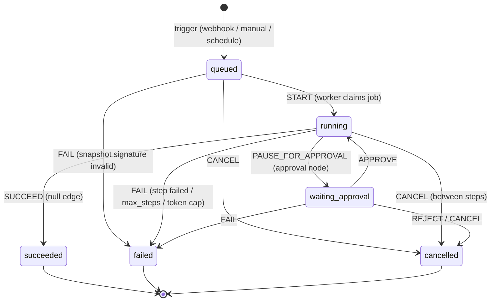

# 03 — Run state machine

Status set (fixed contract): `queued`, `running`, `waiting_approval`, `succeeded`, `failed`,
`cancelled`. Implemented as the State pattern in `domain.run.RunStatus`; the database CHECK
constraint rejects any other value.

| From \ Event | START | PAUSE | APPROVE | REJECT | SUCCEED | FAIL | CANCEL |
|---|---|---|---|---|---|---|---|
| queued | running | – | – | – | – | failed | cancelled |
| running | – | waiting_approval | – | – | succeeded | failed | cancelled |
| waiting_approval | – | – | running | cancelled | – | failed | cancelled |
| terminal | – | – | – | – | – | – | – |

## Who fires each edge

| Edge | Actor | Lock held |
|---|---|---|
| START, PAUSE, SUCCEED, FAIL | worker (`RunExecutor`) | run row `FOR UPDATE` + queue lease |
| APPROVE / REJECT | `ApprovalService` | approval row then run row `FOR UPDATE` |
| CANCEL (queued, waiting_approval, or running with no lease holder) | `CancelService` | run row `FOR UPDATE` |
| CANCEL (running, lease held) | `CancelService` sets `cancel_requested`; the worker applies CANCEL at the next step boundary | run row |

Every transition goes through `RunEntity.apply(event)`, so an illegal edge throws
`IllegalRunTransitionException` instead of corrupting state. A transition and the step row it
belongs to are committed in the same transaction.

## Cancellation semantics (API_CONTRACT §5)

* queued → `cancelled` immediately; the job is deleted; no step ever exists.
* running → cooperative. The in-flight step finishes; `RunExecutor.plan` sees `cancel_requested`
  before choosing the next node. If no worker holds the run (e.g. it is sleeping in a delay), the
  cancel is applied immediately and the waiting step is closed.
* waiting_approval → `cancelled`; the pending approval becomes `cancelled` and is never listed as pending.
* terminal → `409 run_already_terminal`.
* Reject is the second door into `cancelled` (`error.code = approval_rejected`).
