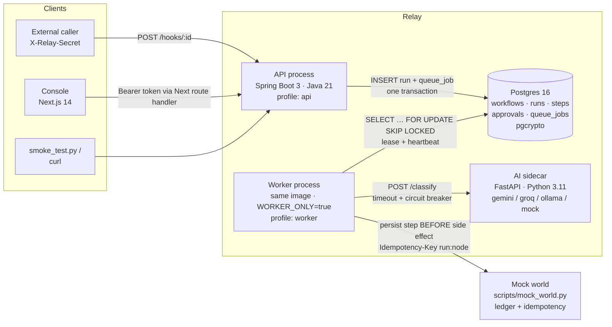

# Relay — AI Workflow Orchestration

Relay is a durable workflow engine whose steps include **machine judgment**. A webhook arrives,
an `ai` node classifies it against a JSON Schema, a `condition` branches on the validated output,
a human approves anything sensitive, and the engine performs the side effect **exactly once**,
even if a worker is `kill -9`'d in the middle.

> The original capstone pack README is preserved at [`docs/reqs/PACK_README.md`](docs/reqs/PACK_README.md).
> The problem statement is [`RELAY_PROBLEM_STATEMENT.md`](RELAY_PROBLEM_STATEMENT.md).

---

## Contents

1. [Architecture](#architecture)
2. [Quickstart](#quickstart)
3. [Environment variables](#environment-variables)
4. [API overview](#api-overview)
5. [Verification: smoke test, kill-and-resume drill, NL eval](#verification)
6. [Design decisions](#design-decisions)
7. [Known limitations](#known-limitations)
8. [Build status](#build-status)

---

## Architecture



| Concern | Where it lives |
|---|---|
| Fixed HTTP contract | `backend/src/main/java/com/relay/api` |
| Publish validation (Chain of Responsibility) | `backend/src/main/java/com/relay/domain/validation` |
| Queue, worker loop, run executor, template resolver | `backend/src/main/java/com/relay/engine` |
| One `NodeExecutor` per catalog node type (Strategy) | `backend/src/main/java/com/relay/nodes` |
| JPA entities, repositories, JDBC queue adapter | `backend/src/main/java/com/relay/persistence` |
| Auth, JWT, PQ crypto, secret vault, log masking | `backend/src/main/java/com/relay/security` |
| Mock-world ACL + AI sidecar client | `backend/src/main/java/com/relay/integrations` |
| AI provider adapters | `ai-sidecar/app/providers` |
| Console | `frontend/` |

The process split is one Spring Boot image started twice: the **API** never executes a node, the
**worker** never serves HTTP. Both share Postgres, which is the queue (see
[ADR-0002](docs/adr/0002-postgres-as-queue.md)).

Deep dives: [`DESIGN/`](DESIGN/00-overview.md).

---

## Quickstart

### Prerequisites

| Tool | Version | Used for |
|---|---|---|
| JDK | 21 (Temurin) | backend + worker |
| Gradle | 8.10+ (or the wrapper, see below) | backend build |
| Node.js | 20 LTS+ (tested with 24) | console |
| Python | 3.11 | AI sidecar, mock world, smoke test |
| Docker + Compose v2 | 24+ | full stack |
| Postgres | 16 (via Docker) | everything durable |

### Option A — whole stack in Docker

```bash
cp .env.example .env
make up            # postgres, mock-world, ai-sidecar, backend (api), worker, frontend
make smoke         # python scripts/smoke_test.py --url http://localhost:8080 --token $RELAY_DEMO_TOKEN
open http://localhost:3000
```

### Option B — run processes locally (fastest dev loop)

```bash
cp .env.example .env
make db                       # postgres only, in docker
make world                    # python scripts/mock_world.py --port 9210
make sidecar                  # uvicorn on :8090, AI_PROVIDER=mock
make api                      # Spring Boot, profile api, :8080
make worker                   # Spring Boot, profile worker (separate JVM)
make web                      # Next.js dev server on :3000
```

First-time Gradle wrapper (only needed once, the wrapper jar is not committed):

```bash
cd backend && gradle wrapper --gradle-version 8.10.2
```

Seeds from `data/seed_workflows.json` are loaded as **published** on API startup.

---

## Environment variables

Full list with defaults in [`.env.example`](.env.example). The important ones:

| Variable | Default | Meaning |
|---|---|---|
| `RELAY_DEMO_TOKEN` | `relay-demo-token` | Bearer token accepted on every platform API (builder + operator + approver) |
| `RELAY_JWT_PUBLIC_KEY` | _(empty)_ | PEM RSA public key; when set, RS256 JWTs with a `roles` claim are also accepted |
| `MOCK_WORLD_URL` | `http://localhost:9210` | Base URL for `notify` and `order_action` |
| `RELAY_URL_ALIASES` | _(empty)_ | `from=>to` rewrites applied to `http_request` URLs at dispatch time (Docker: `http://localhost:9210=>http://mock-world:9210`) |
| `AI_SIDECAR_URL` | `http://localhost:8090` | Where the Java engine sends `ai` node calls |
| `AI_PROVIDER` | `mock` | Sidecar adapter: `mock`, `gemini`, `groq`, `ollama` |
| `GEMINI_API_KEY` / `GROQ_API_KEY` / `OLLAMA_URL` | | Provider credentials (never logged, never returned) |
| `AI_LOG_PROMPTS` | `false` | Only when `true` are full prompts logged |
| `RELAY_MASTER_KEY` | _(dev key)_ | 32-byte base64 KEK wrapping the ML-KEM / X25519 / ML-DSA private keys |
| `RELAY_DB_COLUMN_KEY` | _(dev key)_ | pgcrypto `pgp_sym_encrypt` key for defense-in-depth column encryption |
| `RELAY_PQ_PROVIDER` | `bouncycastle` | `bouncycastle` or `test` (deterministic, tests only) |
| `WORKER_ONLY` | `false` | `true` starts the image as a worker (no HTTP server) |
| `RELAY_WORKER_CONCURRENCY` | `4` | Runs a worker advances in parallel |
| `RELAY_LEASE_SECONDS` | `15` | Queue-job lease; heartbeat renews it every `lease/3` |
| `DATABASE_URL` / `DATABASE_USER` / `DATABASE_PASSWORD` | `jdbc:postgresql://localhost:5432/relay` | Postgres |

---

## API overview

All platform routes require `Authorization: Bearer $RELAY_DEMO_TOKEN`. Webhooks require only
`X-Relay-Secret`. Full reference: [`docs/api.md`](docs/api.md).

```bash
TOKEN=relay-demo-token
URL=http://localhost:8080

# list workflows (seeds are published)
curl -s $URL/workflows -H "Authorization: Bearer $TOKEN"

# create a draft in the seed shape, then publish it
curl -s -X POST $URL/workflows -H "Authorization: Bearer $TOKEN" -H 'Content-Type: application/json' -d '{
  "id":"wf_hello","name":"Hello","trigger":{"type":"manual"},"entry":"hello",
  "limits":{"max_steps":5,"timeout_seconds":60,"max_ai_tokens":0},
  "nodes":[{"id":"hello","type":"notify","params":{"channel":"chat","to":"#general","message":"hi"},"next":null}]}'
curl -s -X POST $URL/workflows/wf_hello/publish -H "Authorization: Bearer $TOKEN"

# manual trigger
curl -s -X POST $URL/workflows/wf_hello/trigger -H "Authorization: Bearer $TOKEN" \
  -H 'Content-Type: application/json' -d '{"input":{}}'
# -> {"run_id":"run_01J…","status":"queued"}

# webhook trigger
curl -s -X POST $URL/hooks/wf_expense_approval -H 'X-Relay-Secret: whsec_expense_774' \
  -H 'Content-Type: application/json' \
  -d '{"employee_email":"dev1@example.com","amount_usd":250,"description":"Conference ticket"}'

# trace
curl -s $URL/runs/run_01J… -H "Authorization: Bearer $TOKEN"

# approvals
curl -s "$URL/approvals?status=pending" -H "Authorization: Bearer $TOKEN"
curl -s -X POST $URL/approvals/apr_…/approve -H "Authorization: Bearer $TOKEN"
curl -s -X POST $URL/approvals/apr_…/reject  -H "Authorization: Bearer $TOKEN"

# cancel
curl -s -X POST $URL/runs/run_…/cancel -H "Authorization: Bearer $TOKEN"
```

Errors always look like:

```json
{"error":{"message":"Node 'n1' has unknown type 'teleport'","code":"invalid_node_type","trace_id":"…","details":{}}}
```

---

## Verification

### Smoke test

```bash
python scripts/mock_world.py --port 9210         # if not using docker
python scripts/smoke_test.py --url http://localhost:8080 --token relay-demo-token
```

### Kill-and-resume drill (follows EVALUATION_GUIDE §2 exactly)

```bash
make drill        # scripted version of the steps below
```

```bash
curl -X POST http://localhost:9210/admin/reset
curl -X POST http://localhost:8080/workflows/wf_slow_fulfillment/trigger \
  -H "Authorization: Bearer relay-demo-token" -H "Content-Type: application/json" \
  -d '{"input": {"order_id": "ord_2003", "customer_email": "lena@example.com"}}'
# wait for the confirmation email in GET :9210/admin/ledger, then during the 20 s pack_delay:
docker kill --signal KILL relay-worker          # or: kill -9 <worker pid>
docker compose -f docker/docker-compose.yml start worker
python scripts/duplication_check.py --url http://localhost:9210
```

### NL compiler eval (Good To Have)

```bash
make nl-eval      # POSTs every data/nl_eval.jsonl description to /workflows/compile and scores it
```

The verification report template lives in [`docs/runbook.md`](docs/runbook.md).

---

## Design decisions

| Topic | Decision | Doc |
|---|---|---|
| Repo layout | Monorepo: Gradle backend, npm-workspace frontend, Python sidecar | [ADR-0001](docs/adr/0001-monorepo.md) |
| Queue | Postgres `queue_jobs` + `FOR UPDATE SKIP LOCKED` + lease/heartbeat | [ADR-0002](docs/adr/0002-postgres-as-queue.md) |
| Run state machine | Six contract states, explicit transition table, State pattern | [DESIGN/03](DESIGN/03-run-state-machine.md) |
| Exactly-once | Persist step intent → send with `Idempotency-Key` `{run_id}:{node_id}` → persist result; resume re-sends the same key | [DESIGN/04](DESIGN/04-idempotency-and-exactly-once.md) |
| Approval gate | Engine query over `approvals` rows (signed with ML-DSA-65) before any `requires_approval` node | [DESIGN/07](DESIGN/07-approval-gating.md) |
| AI node | Sidecar adapter, Java-side JSON Schema validation, one repair retry, no transient-retry burn | [DESIGN/06](DESIGN/06-ai-node-design.md) |
| Crypto | Hybrid ML-KEM-768 + X25519 → HKDF-SHA3-256 → AES-256-GCM; ML-DSA-65 snapshot signatures | [ADR-0003](docs/adr/0003-pq-crypto.md), [DESIGN/05](DESIGN/05-security-and-crypto.md) |
| AI language | Python FastAPI sidecar so the provider is swappable and mockable | [ADR-0004](docs/adr/0004-python-ai-sidecar.md) |

---

## Known limitations

- **Single worker by default.** The queue uses leases and `SKIP LOCKED`, so multiple workers are
  safe by construction, but the multi-worker drill is Stretch and not part of the verification.
- **Schedule granularity is 1 minute**; missed windows are not caught up.
- **Mid-step abort is not supported.** Cancellation is cooperative between steps (per contract).
- **Crypto is software-only.** ML-KEM (FIPS 203) / ML-DSA (FIPS 204) come from BouncyCastle; keys
  are wrapped by an environment-supplied KEK, not an HSM/KMS.
- **`limits.timeout_seconds` is off by default** (flag `relay.engine.enforce-timeout`) because a
  wall-clock cap would cancel runs that are legitimately waiting on a human approval.
- **The seeds hardcode `http://localhost:9210`.** Inside Docker that is rewritten at dispatch time
  via `RELAY_URL_ALIASES`; the stored definition and snapshot are never mutated.

---

## Build status

Steps 1–17 of the execution plan are implemented. Progress is recorded step by step in
[`docs/reqs/step-log.md`](docs/reqs/step-log.md); requirement coverage (requirement → reference →
test → implementation) is in [`docs/reqs/traceability.md`](docs/reqs/traceability.md).

| Part | Verified on the build machine? |
|---|---|
| Console (`frontend/`) | **Yes** — 33 Vitest/RTL tests pass, `tsc --noEmit`, ESLint and Prettier clean, `next build` succeeds |
| Backend (`backend/`) | **Yes** (2026-10-08, in Docker): unit tests all pass; integration tests (Testcontainers Postgres 16) all pass incl. engine, approvals, injection gate, caps, cancellation, crash recovery |
| Full stack (`docker compose`) | **Yes**: `smoke_test.py` 28 passed / 0 warnings / 0 failed; kill-and-resume drill (SIGKILL during `pack_delay`) + `duplication_check.py` → PASS; live triage refund: paused at the gate, 1 refund only after approval |
| AI sidecar unit tests (`ai-sidecar/`) | Not yet run (the sidecar container itself runs and serves the stack); `pip install -e ".[dev]" && pytest` |

No local JDK or Python is needed — see [Running without Java/Python installed](docs/runbook.md#running-without-javapython-installed).

New to the project? Start with the
[**Application Functionality Guide**](docs/guides/application-functionality.md).

Other docs: [API reference](docs/api.md) · [runbook + verification report template](docs/runbook.md) ·
[demo script](docs/demo-script.md) · [ADRs](docs/adr) · project skill
[`.claude/skills/relay/SKILL.md`](.claude/skills/relay/SKILL.md).
